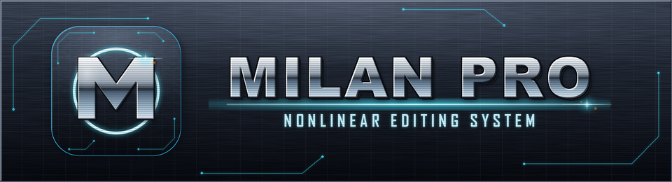
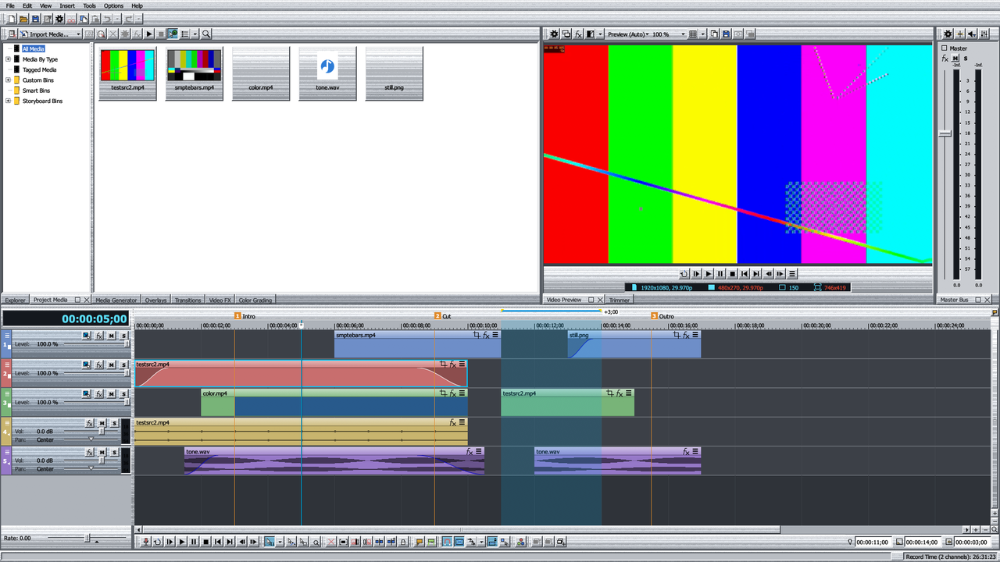

<p align="center"></p>

# Milan Pro

An open-source nonlinear video editor written in Rust, with a workflow modeled on Sony VEGAS Pro.

> Early development (v0.9). Editing, preview, effects, transitions, titles, audio FX, OFX video plug-ins, VST3 and CLAP audio plug-ins, recording, rendering and interchange with other editors work. What is still being built is listed under [Roadmap](#roadmap).

<p align="center"></p>
<p align="center"><sub>Taken by the screenshot harness on its demo project.</sub></p>

## Features

| Area | Status in 0.9 |
|---|---|
| Interface | One look modelled on the Windows video editors of 2005-2007, on VEGAS Pro's window layout, with VEGAS menus, shortcuts, toolbars, docking and saved window layouts; floating windows; customizable keyboard and toolbars; a command palette |
| Editing | Multitrack video and audio; move, trim, split, snapping and grid; ripple; slip, slide, roll and stretch; takes; groups; subclips; nested timelines; multicamera editing; Expanded Edit and edge trimming; markers, regions and command markers; adjustment tracks and events; undo/redo |
| Effects and compositing | Video FX, transitions and generators (Titles & Text, Credit Roll, Test Pattern and more) with presets and keyframes; Color Grading with `.cube` LUTs; Event Pan/Crop with Bezier masks; Track Motion in 2D and 3D; parent/child compositing and all VEGAS compositing modes; Video Scopes |
| Preview | Real-time multi-layer preview composited on the GPU (wgpu on Vulkan) or the CPU; persistent decoders and frame caches; proxies; Dynamic RAM Preview and Selectively Prerender Video; a disk cache for heavy sources; hardware decoding when it measures faster |
| Audio | Streaming mixer with busses, assignable FX chains, sends, six pan types and automation; Mixing Console and Loudness Meters; built-in audio FX; recording and input monitoring; cpal or WASAPI exclusive output |
| Plug-ins | Third-party OFX video effects, transitions and generators; VST3 and CLAP audio effects with presets and latency compensation, and VST3 editor windows; all in a separate process, so a crash cannot take the editor down |
| Render | Render As through the preview's own engine with 38 built-in templates and your own; render queue, Batch Render, Render to New Track; NVENC, Quick Sync, AMF and Media Foundation encoders after a startup test |
| Interchange | VEGAS Pro both ways through scripts; OpenTimelineIO; CMX 3600 EDL; FCP7 XML (Premiere Pro, DaVinci Resolve); FCPXML 1.10; AAF through OpenTimelineIO's adapter; project archive ([docs/INTERCHANGE.md](docs/INTERCHANGE.md)) |
| Reliability | `.mnle` JSON project files with versioned migrations and `.mnle.bak`; autosave and crash recovery; logs, crash reports and a diagnostic report; an auto-updater with channels, verification and rollback |
| Not yet | Multichannel and surround audio, a 10-bit / HDR pipeline, subtitles, image sequences, camera RAW formats, bins and metadata search: see [Roadmap](#roadmap) |

## System requirements

- Windows 10 or 11, 64-bit.
- A GPU with Vulkan drivers for GPU compositing (without one, Milan Pro composites on the CPU).
- 8 GB of memory or more; 16 GB for 4K. A multi-core CPU: decoding and CPU compositing use every core.
- Disk space for the program and its bundled FFmpeg (a few hundred MB), plus room for proxies, caches and renders.
- Hardware decoding and encoding (optional): an NVIDIA, Intel or AMD GPU whose drivers FFmpeg supports. Milan Pro tests them at first start and uses only what works.

## Interface

Milan Pro's interface is modelled on the Windows video editors of 2005-2007: brushed-metal, 3D-bevelled chrome (Tahoma 8 pt, raised toolbars, sunken white lists, Windows 2000-style dialogs and controls, a black LCD time display) on VEGAS Pro's window layout, with VEGAS's menus, shortcuts and docking areas. Window layouts can be saved and recalled as in VEGAS.

## Overlay packs

**View > Window > Overlays** keeps your overlay video packs (light leaks, film grain, dust and scratches, bokeh, flares, frames, keyed elements) in a library folder, by default `Documents\Milan Pro\Overlay Packs` (change it in **Options > Preferences > General**). Each pack is a subfolder: **Import Pack...** copies a folder or extracts a `.zip` into the library, or links an existing folder where it is. Browse by pack, favourites, recent or search (names and tags), with thumbnails that scrub as you hover. Drag an overlay onto the timeline, or double-click it to add it at the cursor on a new track; the new track gets the overlay's blend (Normal, Screen, Add, Multiply, Overlay, or a green/blue screen key), set per pack in **Pack Properties** or per overlay from its right-click menu. Removing a copied pack moves its folder to the Recycle Bin; nothing is deleted for good. Milan Pro ships no third-party overlays; **Create Sample Pack** makes a few with FFmpeg.

## Install (Windows)

Download `MilanPro-<version>-Setup.exe` from [Releases](../../releases) and run it. It installs per-user by default (no admin needed), adds a Start Menu shortcut, and can be removed from Settings > Apps.

The installer bundles [FFmpeg](https://ffmpeg.org/) 9.0.2 (GPL v3, build by Gyan Doshi), installed next to `MilanPro.exe`. Source links are in `FFMPEG-SOURCE.txt` in the install folder. When building from source, run `installer/fetch-ffmpeg.ps1` or have FFmpeg on `PATH`.

## Updates

A few seconds after startup Milan Pro asks GitHub for the latest release (it sends only a `MilanPro-Updater/<version>` user agent). When a newer version exists it shows the release notes with **Download and install**, **Remind me later** and **Skip this version**. The installer is downloaded over HTTPS, checked against its SHA-256 (`MilanPro-<version>-Setup.exe.sha256`, or the release's asset digest), and run silently; Milan Pro asks to save your project, closes, updates and starts again. Check by hand with **Help > Check for Updates...**, or turn the startup check off in **Options > Preferences > Update**.

The Update page also has the channel (**Stable**, or **Preview** for pre-releases), the skipped version, and **Keep the previous version's installer**: with it on, the current version's own installer is fetched from its release (verified the same way) before an update, and **Help > Roll Back to Previous Version** reinstalls it. A version that fails to start twice after an update offers the roll back by itself. Updates are never installed while a render or a recording is running.

Verification: the download's SHA-256 must match the release. Once the maintainer's minisign key pair exists, the checksum file is signed (`.minisig`) and the public key is compiled into Milan Pro, which then refuses unsigned updates; until then the update dialog says "SHA-256 only". Code signing: not yet (certificate pending). See [SECURITY.md](SECURITY.md).

## Import from VEGAS Pro

Milan Pro cannot read `.veg` files directly (`docs/research/VEG_FORMAT.md`). In VEGAS, choose **Tools > Scripting > Run Script...** and pick `Export to Milan Pro.cs` from the `vegas` folder of the Milan Pro install (`tools/vegas` in the source; use the `(VEGAS 13)` copy in VEGAS Pro 13 and earlier). It writes `<project>.milan.json`; open that in Milan Pro with **File > Import > VEGAS Project...**. Tracks, events (Pan/Crop, subclips, reversed events, velocity), fades, takes, groups, envelopes, Track Motion, parent/child compositing, transitions, generated media, event/track/media/output FX with their keyframes, audio FX by name, markers, regions and the project settings come across; VEGAS plug-ins that have a Milan Pro counterpart become it with their settings converted, the rest are kept as disabled OFX placeholders (they play once the plug-in is installed) and Milan Pro lists them. Picking a `.veg` there instead only adds the media it uses to Project Media.

The other way, **File > Export > VEGAS Project (via script)...** writes the same kind of file, and `Import from Milan Pro.cs` (same folder) rebuilds the project inside VEGAS through its scripting API; Milan Pro never writes `.veg` files. **File > Export > Milan Pro Project Archive...** copies a project with its media into one folder (optionally trimmed to the used ranges), and **File > Import > Media from Project...** pulls another project's media in. `docs/INTERCHANGE.md` has the details.

## OFX plug-ins

Milan Pro runs third-party OFX video effects, transitions and generators (Filter, General, Transition and Generator contexts; 8-bit, 16-bit, half or 32-bit float) in **milan-plugin-host.exe**, a separate process installed next to `MilanPro.exe`: a plug-in that crashes or hangs is stopped and bypassed with a message, and Milan Pro keeps running. Its settings stay in the project, so nothing is lost.

- **Where Milan Pro looks:** `C:\Program Files\Common Files\OFX\Plugins` (the standard folder, where installers put `*.ofx.bundle` folders), every folder in the `OFX_PLUGIN_PATH` environment variable (separated by `;`), and folders you add in **View > Window > Plug-In Manager > Folders > Add Folder...**.
- **Using them:** found effects appear in the Video FX window under their own grouping (for example "spektrafilm OFX"), transitions in the Transitions window and generators in Media Generators, and apply like the built-in ones, with their parameters and keyframes in the FX window. The FX window lays out an OFX plug-in's controls as the plug-in defines them (pages, groups, hidden and greyed parameters, labels and choice options it changes at run time) and runs its push buttons (Save Preset, Export LUT and the like) in the plug-in host; what the plug-in changes itself is written to the project. Projects store them as `ofx:<identifier>@<major version>`; a project that uses a plug-in you do not have keeps its settings and shows the FX as missing, with a red "!" on the event's fx button.
- **Plug-In Manager** (View > Window, Ctrl+Alt+1): every plug-in with its status (OK, Failed with the reason, Disabled), a check box to turn one off, and **Rescan** (reads every plug-in again and tries failed ones again). Results are cached in `%LOCALAPPDATA%\MilanPro\plugins.json`.
- **Limits:** Milan Pro does not provide GPU render suites (CUDA, OpenCL, Metal, OpenGL), overlays/on-screen controls, custom parameter UIs, parametric (curve) parameters, OFX 1.5 colour management or other frames than the current one (temporal access). Plug-ins that need these, or that only run in a particular host (DaVinci Resolve-only plug-ins; the VEGAS Pro OFX bundles, which need VEGAS's private suites and DLLs: see `docs/compat/ofx-vegas15.md`), fail with the reason shown. See `docs/compat/ofx-spektrafilm.md` for Spektrafilm.

The OFX C API bindings in `src/bin/milan-plugin-host/ofx.rs` were written from the OpenFX 1.4 headers, Copyright (c) 2003-2015 The Open Effects Association Ltd, used under the BSD 3-Clause licence.

## VST3 and CLAP plug-ins

Milan Pro runs third-party **VST3** and **CLAP** audio effects (stereo, 32-bit float, at the project's 48 kHz) in the same **milan-plugin-host.exe** process as OFX: a plug-in that crashes or hangs is stopped and bypassed with a message, and Milan Pro keeps running. Its settings stay in the project.

- **Where Milan Pro looks:** `C:\Program Files\Common Files\VST3` and `%LOCALAPPDATA%\Programs\Common\VST3` (`.vst3` bundles or single files), `C:\Program Files\Common Files\CLAP` and `%LOCALAPPDATA%\Programs\Common\CLAP` (`.clap` files), and folders you add in **Options > Preferences > VST Effects** (or Plug-In Manager > Folders). A VST3 bundle's `moduleinfo.json` is cross-checked against what its factory reports.
- **Using them:** found effects appear in the Audio FX menu (fx+ in the FX window) under their vendor and apply to events, tracks, busses and the master like the built-in audio FX, in preview and in renders, with their parameters, keyframes and FX automation envelopes in the FX window. A plug-in's latency is compensated in the mixer (plug-in delay compensation, sample-exact: every other path is delayed to match, and the mix runs that far ahead). **Show plug-in UI** opens the plug-in's own editor in a window of the plug-in host (resizable; it closes with Milan Pro); what you change there is written to the project, as FX automation keys while the track records automation (Write Touch/Latch) and plays, else as values. **Load/Save .vstpreset** read and write Steinberg's preset file format; program lists appear as a Program parameter. Projects store them as `vst3:<class id>` or `clap:<id>` with the parameter values and the plug-in's own state; a project that uses a plug-in you do not have keeps its settings and shows the FX as missing, with a red "!" on the event's fx button.
- **Plug-In Manager** (View > Window, Ctrl+Alt+1): VST3 and CLAP effects with their status, a check box to turn one off, and **Rescan**; results are cached in `%LOCALAPPDATA%\MilanPro\plugins.json` with the OFX plug-ins.
- **Limits:** stereo effects only (instruments, MIDI effects, mono- or surround-only plug-ins are listed as unsupported); CLAP plug-ins have no editor window yet; parameter changes are sent once per block (1024 frames); the editor's controls are not shown in Milan's generic parameter grid beyond the plug-in's own parameter list. **VST2** is not supported: Steinberg no longer licenses its SDK. **DirectX (DMO)** audio plug-ins were investigated and not pursued (`docs/compat/dx-audio.md`).

VST3 is hosted through the `vst3` crate (coupler-rs, MIT OR Apache-2.0; Steinberg's VST 3 SDK is MIT-licensed from version 3.8, and Milan Pro ships no SDK code: see [docs/LICENSES.md](docs/LICENSES.md)) and CLAP through `clap-sys` (MIT OR Apache-2.0). The test plug-ins in `tools/vst3-test-plugin` and `tools/clap-test-plugin` are Milan Pro's own.

## Build from source

```bash
cargo build --release
```

Requires Rust 1.85+ (edition 2024) on Windows. The binaries are written to `target/release/milan-pro.exe` and `target/release/milan-plugin-host.exe` (the OFX / VST3 / CLAP plug-in host, which must sit beside it). FFmpeg comes from `installer/fetch-ffmpeg.ps1` or `PATH`. [docs/DEVELOPING.md](docs/DEVELOPING.md) covers tests, the screenshot harness, benchmarks and releases.

## Documentation

| Document | What it covers |
|---|---|
| [docs/ARCHITECTURE.md](docs/ARCHITECTURE.md) | Modules, threads, the engine's data flow, the plug-in host, theming, the test strategy and the technology decisions |
| [docs/DEVELOPING.md](docs/DEVELOPING.md) | Building, testing, the screenshot harness, adding commands, dialogs and plug-ins, releasing |
| [docs/REFERENCE_ANALYSIS.md](docs/REFERENCE_ANALYSIS.md) | The VEGAS Pro reference installation and how VEGAS's model maps onto Milan Pro's |
| [docs/REMAINING.md](docs/REMAINING.md) | Every requirement with its status, and the batches still to build (the roadmap) |
| [docs/FEATURE_PLAN.md](docs/FEATURE_PLAN.md) | The original engine design and its reasoning |
| [Look specification](docs/UI_SPEC.md) | How the interface is drawn |
| [docs/VEGAS_UI_SPEC.md](docs/VEGAS_UI_SPEC.md) | VEGAS Pro's interface, measured: the reference for layout, menus and keys |
| [docs/INTERCHANGE.md](docs/INTERCHANGE.md) | VEGAS, OTIO, EDL, FCP XML and FCPXML import and export, field by field |
| [docs/COMPATIBILITY.md](docs/COMPATIBILITY.md) | Audio devices, VEGAS projects, interchange formats and plug-ins: what works with what |
| [docs/FORMAT_SUPPORT.md](docs/FORMAT_SUPPORT.md) | Media and render formats |
| [docs/PERFORMANCE.md](docs/PERFORMANCE.md) | Playback and compositing benchmarks |
| [docs/AE_PREMIERE_PLUGINS.md](docs/AE_PREMIERE_PLUGINS.md) | The plan for hosting After Effects / Premiere Pro effect plug-ins |
| [docs/LICENSES.md](docs/LICENSES.md) | Every dependency's licence, FFmpeg's GPL, codec patents, plug-in SDKs |
| [docs/compat/](docs/compat/) | Plug-in compatibility reports (VEGAS's OFX bundles, Spektrafilm, DirectX audio) |
| [CHANGELOG.md](CHANGELOG.md) | What changed in each release |
| [CONTRIBUTING.md](CONTRIBUTING.md), [CODE_OF_CONDUCT.md](CODE_OF_CONDUCT.md), [SECURITY.md](SECURITY.md) | How to contribute, how we behave, how to report a security problem |

## Roadmap

The full list, with scope and acceptance tests per batch, is section 5 of [docs/REMAINING.md](docs/REMAINING.md). Still open after 0.8.0:

- **Media:** a format capability report and test corpus (R37), image sequences and stills (R38), subtitles and closed captions (R39), HDR detection and display (R40a), a 10-bit / HDR pipeline (R40b), multichannel and surround audio with the Surround Panner (R10a, R10b), professional camera formats where FFmpeg can read them (R41).
- **Media management:** bins, tags, smart bins and metadata search (R45a); a metadata inspector, duplicates and relinking (R45b).
- **Interface:** high-DPI scaling and an animation policy (R48); the remaining Preferences pages and preference export (R49).
- **Project:** a Cargo workspace split (R50), CI quality gates (R51), the public compatibility matrix and example VEGAS projects (R55).
- **Plug-ins:** CLAP editor windows, OFX GPU render paths, and After Effects / Premiere Pro effect hosting ([docs/AE_PREMIERE_PLUGINS.md](docs/AE_PREMIERE_PLUGINS.md)).
- **VEGAS long tail** (R57-R60, to be decided): media and event commands, disc burning, control surfaces, scripting.

## Contributing

Bug reports, plug-in compatibility reports and pull requests are welcome: see [CONTRIBUTING.md](CONTRIBUTING.md). Everyone taking part follows the [Code of Conduct](CODE_OF_CONDUCT.md).

## License

MIT. See [LICENSE](LICENSE). Third-party licences, including FFmpeg's GPL v3, are in [docs/LICENSES.md](docs/LICENSES.md) and, in the install folder, `THIRD-PARTY-NOTICES.txt`. Milan Pro isn't affiliated with or endorsed by VEGAS Creative Software or Sony. VEGAS is a trademark of its owner; VST is a trademark of Steinberg Media Technologies GmbH.
